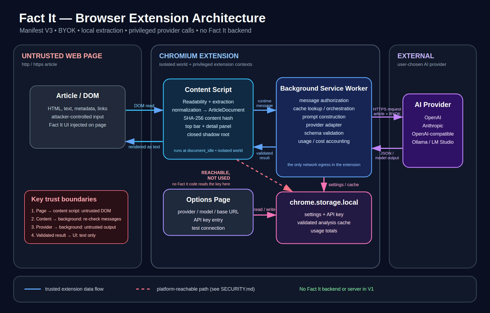

# Fact It - Architecture

## MVP Architecture

Source: [docs/images/architecture.svg](docs/images/architecture.svg).
Re-render after editing it:

    chromium --headless --screenshot=docs/images/architecture.png \
      --window-size=1800,1150 docs/images/architecture.svg

Pipeline:

Web Page
   |
   v
Content Extraction
   |
   v
Normalization
   |
   v
ArticleDocument
   |
   v
Provider Adapter
   |
   v
LLM
   |
   v
Analysis JSON
   |
   v
Schema Validation
   |
   +----------------+
   |                |
   v                v
Fact It Bar     Detail Panel

The dashed path in the diagram is a Chromium platform property, not a
Fact It data flow: chrome.storage.local is readable from any content
script in the extension. No Fact It code reads the API key there - the
key is read only by the background service worker and the options page.
See SECURITY.md.

## Analysis model (ADR-008)

ARTICLE
   |
   v
CLAIM EXTRACTION
   |
   +-----------------------+
   |                       |
   v                       v
CLAIM CONSISTENCY      SOURCE TRANSPARENCY
   |                       |
   +-----------+-----------+
               |
               v
       CONTENT ANALYSIS
      (contradiction, attribution, headline, statistics, framing)
               |
               v
        CONCERN ENGINE (validator derives the status from concerns)
               |
        +------+------+
        |             |
        v             v
 No material      Material concerns
 concerns         (moderate / significant)
        |             |
        v             v
      GREEN       YELLOW / RED

Parallel metadata: EXTERNAL VERIFICATION = NOT PERFORMED (V1). It never
affects the concern level.

## content/

Responsible for webpage interaction.

Includes:

- article extraction
- DOM interaction
- Fact It UI injection

Content scripts must not receive API keys.

## background/

Extension orchestration.

Responsible for privileged operations and provider communication.

## providers/

AI provider adapters.

All providers expose one text-completion primitive (ADR-004):

    complete({ system, input, maxTokens })
      -> { text, model, provider, finish, usage }

Adapters know nothing about articles, prompts or the analysis schema.
They build the HTTP request, parse the reply and map errors. Prompt
construction and validation live in analysis/, so a new provider is
one adapter file plus a test, never a second analysis engine.

The single network egress is the `send` helper in providers/common.js,
called only from the background worker.

## analysis/

Responsible for:

- prompts and prompt versioning (docs/PROMPT.md)
- schemas (docs/ANALYSIS_SCHEMA.md, currently 2.3)
- validation and migration of cached results
- result normalization

The analysis model is concern detection (ADR-007, ADR-008, ADR-012,
ADR-013): claims are classified before they are judged, external
verification is metadata and never a concern, and the overall status is
derived by the validator from concerns, including those a claim's own
support level implies. A page whose text was not read is not analyzed
(ADR-014).

## storage/

Responsible for:

- settings
- provider configuration
- local cache

## ui/

Fact It interface.

Primary component:

thin top indicator.

Secondary component:

expanded analysis panel.

## Future Boundary

Evidence Engine and Community must remain logically independent.

Browser DOM code must not become coupled to future backend
architecture.
